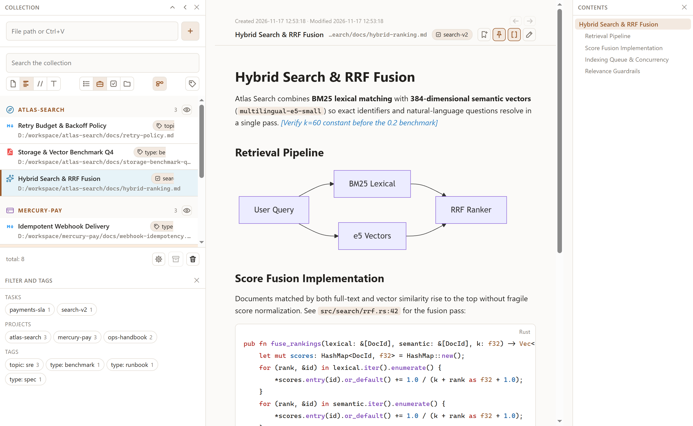
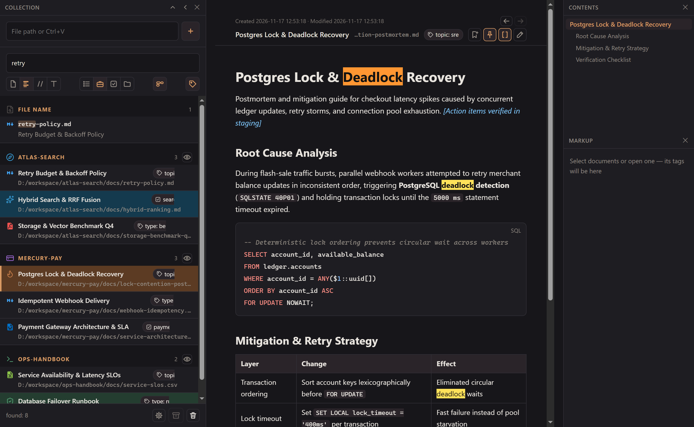
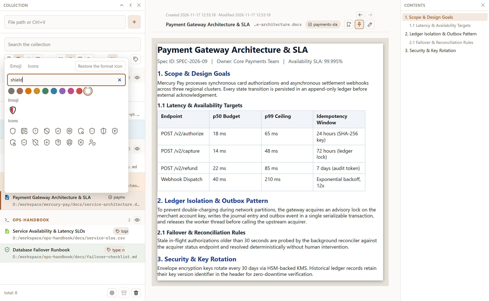
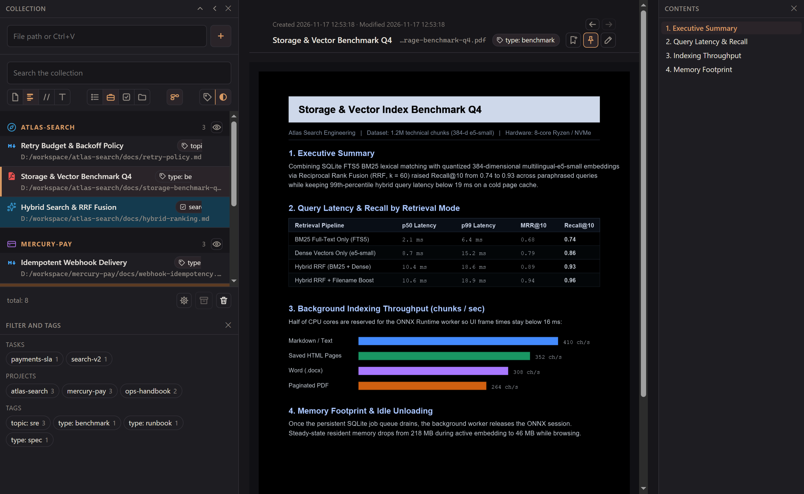

# md-keeper

**[English](README.md) · [Русский](README.ru.md) · Deutsch · [Español](README.es.md)**

Eine lokale Dokumentensammlung — Markdown, Word (`.docx`), PDF, gespeicherte Webseiten, Textdateien und CSV-Tabellen — mit hybrider Volltext- und semantischer Suche für Windows und Linux.

Entwickelt für alle, die Architekturnotizen, Spezifikationen, Postmortems, Berichte und gespeicherte Webseiten über verschiedene Ordner und Repositories verteilt aufbewahren — auch direkt neben einer IDE und Sitzungen in Claude Code.

Die Dateien bleiben genau dort auf der Festplatte, wo sie liegen: In die Sammlung gelangen nur Pfad, Titel, durchsuchbarer Text, Tags und Suchvektoren. Das Modell für die semantische Suche (`multilingual-e5-small`) läuft lokal innerhalb des Programms über ONNX Runtime — es werden keine Netzwerkports geöffnet und es ist keine Internetverbindung erforderlich. Text verlässt Ihren Computer nur in einem einzigen Fall und nur mit Ihrer ausdrücklichen Zustimmung: wenn ein lokal installiertes und angemeldetes Claude Code (`claude`) anhand der ersten 1500 Zeichen einen Titel für ein Dokument ohne Überschrift vorschlägt.

[**Neueste Version herunterladen**](../../releases/latest)



## Funktionen

### Hybride Suche: Exakte Wörter, Bedeutung und Dateinamen

- **Drei Signale in einem Suchfeld.** Die Volltextsuche findet exakte Bezeichner, Ticketnummern und Symbole im Code; die Vektorsuche findet Dokumente nach Anfragen in eigenen Worten; beide Ranglisten werden über Reciprocal Rank Fusion (RRF) zusammengeführt. Treffer im Dateinamen oder am Ende des Pfads stehen als eigene Gruppe ganz oben, damit bekannte Dateien sofort an erster Stelle erscheinen.
- **Sofort nach Wörtern durchsuchbar, Hintergrund-Warteschlange für Vektoren.** Ein neu hinzugefügtes Dokument wird sofort über die Wörter im Text gefunden, während die Vektoren im Hintergrund auf der Hälfte der Prozessorkerne berechnet werden, ohne die Oberfläche zu blockieren. Die Warteschlange liegt in derselben SQLite-Datenbank wie die Sammlung: Wird das Programm zwischendurch geschlossen, geht nichts verloren und die Arbeit wird beim nächsten Start fortgesetzt.
- **Suche im Dokument (`Strg+F`).** Springen Sie direkt durch alle Treffer im geöffneten Markdown-, Word-, PDF-, HTML-, Text- oder CSV-Dokument.



### Lesen im Originallayout — im hellen und dunklen Design

- **Neun Dateiendungen, eigene Betrachter.** Unterstützt werden `.md`, `.markdown`, `.mdown`, `.docx`, `.pdf`, `.html`, `.htm`, `.txt` und `.csv`:
  - **Markdown** wird mit Syntaxhervorhebung für Codeblöcke, **Mermaid**-Diagrammen, Tabellen und einer optionalen Hervorhebung für `[Notizen in eckigen Klammern]` dargestellt.
  - **Word (`.docx`)** wird seitenweise mit eigenem Layout, Kopf- und Fußzeilen sowie Tabellen gezeichnet.
  - **PDF** wird seitenweise mit Textauswahl und Zoom angezeigt.
  - **Gespeicherte Webseiten (`.html`)** öffnen sich mit ihren eigenen Stilen und Bildern aus dem Nachbarordner, während Skripte standardmäßig in einer Sandbox ausgeschaltet bleiben (für interaktive Folien lassen sie sich pro Dokument in der Kopfleiste einschalten).
- **Inhaltsverzeichnis für alle Formate.** Erzeugt aus Überschriften bei Markdown und HTML, aus Absätzen mit Überschriftenformatvorlage bei Word und aus den Lesezeichen der Datei bei PDF.
- **Dunkles Design bis in die Dokumente.** Im dunklen Design werden Word-Dokumente und Webseiten umgefärbt (heller Text bei unveränderten Fotos und Diagrammen), während PDFs invertiert werden; über das Symbol im Dokumentkopf kehren Sie jederzeit zu den echten Farben zurück.
- **Lesestellen und Verlauf.** Die Scrollposition wird für jedes Dokument automatisch gemerkt. Über den Dokumentkopf lassen sich weitere **Lesestellen** (`1`, `2`, … oder `Alt+1`, `Alt+2`) anlegen, um in langen Dokumenten zwischen Abschnitten zu wechseln, sowie per `Alt+←` / `Alt+→` oder den Seitentasten der Maus durch den Verlauf geöffneter Dokumente blättern.





### Ordnung schaffen, ohne Dateien auf der Festplatte anzufassen

- **Automatische Projekterkennung.** md-keeper sucht vom Dateiordner aus aufwärts nach Projektmerkmalen (`.git`, `package.json`, `*.sln`, `.slnx`) und ordnet Dokumente aus einem `git-worktree` dem Haupt-Repository zu. Dadurch funktionieren die Gruppierung **„Projekt“** und der Projektfilter sofort — selbst ohne einen einzigen Tag. Projekte lassen sich direkt im Gruppenkopf umbenennen oder von Hand zuweisen.
- **Mehrachsige Tags, Zeilenfarben und eigene Symbole.** Versehen Sie Dokumente mit `Achse: Wert`-Tags und Aufgaben (`задача: …`), gruppieren Sie die Liste nach **Projekt**, **Aufgabe** oder **Ordner** und ordnen Sie Gruppen und Dokumente per Drag-and-Drop an. Zeilen lassen sich in 9 Farben einfärben (jeweils abgestimmt auf helles und dunkles Design) und Formatsymbole bei Dokumenten oder Gruppen durch **Emojis** oder farbige **Lucide**-Symbole ersetzen.
- **Ausblenden und umkehrbares Entfernen.** Das Augensymbol im Gruppenkopf oder `Alt+Klick` auf einen Tag blendet Gruppen oder Tags vorübergehend aus der Ansicht aus, ohne die Dokumente zu ändern. Das Ausblenden über das Papierkorb-Symbol nimmt Dokumente umkehrbar aus Liste und Suche; Dateien auf der Festplatte werden niemals verändert oder gelöscht.
- **Umgezogene Dateien wiederfinden.** Wurde eine Datei verschoben oder ein `git-worktree` gelöscht, bleibt der Eintrag samt Text und Tags erhalten. Die Lupe in der Zeile sucht unterhalb des Projektstamms nach passenden Pfadenden oder Dateinamen und setzt den Eintrag auf die gefundene Datei um.

### Aus Notizen direkt zur Codezeile in der IDE springen

- Hinterlegen Sie in den **Einstellungen** unter **„IDE-Befehl“** eine Befehlsvorlage (mit den Platzhaltern `{path}`, `{line}` und `{project}`). Ein Klick auf einen Dateipfad oder Markdown-Link mit Zeilennummer (z. B. `src/search/rrf.rs:42` oder `#L42`) öffnet die Datei in Ihrer IDE genau an dieser Zeile.
- Links der Form `jetbrains://…/navigate/…` werden über JetBrains Toolbox geöffnet.
- Ausführbare Dateien (`.exe`, `.bat`, `.cmd`, `.ps1`, `.sh`, `.desktop`, `.AppImage` usw.) werden über Links in Dokumenten niemals gestartet.

### Fenster, Infobereich (Tray) und `mdk`-Befehl

- **Vier Oberflächensprachen:** **English**, **Русский**, **Deutsch** und **Español** — automatisch anhand der Systemsprache gewählt oder jederzeit im Menü des Symbols im Infobereich umschaltbar.
- **Arbeitet im Infobereich weiter:** Das Schließen des Fensters minimiert es in den Infobereich, sodass die Hintergrundindizierung weiterläuft; auf Wunsch startet das Programm beim Anmelden direkt im Infobereich.
- **Kommandozeilenwerkzeug `mdk`:** Wird im `PATH` installiert und nutzt denselben Datenordner — ideal für Terminalskripte und Sitzungen in Claude Code:

| Befehl | Funktion |
|---|---|
| `mdk add <Pfad>` | Datei zur Sammlung hinzufügen (und einen Titel über Claude anfordern, falls aktiviert und keine Überschrift vorhanden ist). |
| `mdk list` | Alle Dokumente der Sammlung auflisten. |
| `mdk sync` | Mit der Festplatte abgleichen: geänderte Dateien neu einlesen, fehlende markieren, zurückgekehrte wiederherstellen. |
| `mdk titles` | Titel für Dokumente nachholen, die noch den Dateinamen als Titel tragen. |
| `mdk reindex [Pfad]` | Suchvektoren vollständig neu berechnen. |

## Installation

Laden Sie das Installationsprogramm oder Paket unter [**Releases**](../../releases/latest) herunter.

### Windows 10 und 11 (x64)

Starten Sie `md-keeper_X.Y.Z_x64-setup.exe`. Es sind keine Administratorrechte erforderlich:

- Installiert das Programm für den aktuellen Benutzer unter `%LOCALAPPDATA%\Programs\md-keeper`, legt Verknüpfungen auf dem Desktop und im Startmenü an und trägt `mdk.exe` in den Benutzer-`PATH` ein (starten Sie das Terminal nach der Installation neu, damit der neue `PATH` übernommen wird).
- Auf der Seite **„Datenordner“** können Sie den Standardordner (`%LOCALAPPDATA%\md-keeper\data`) übernehmen oder einen anderen wählen. Der Zeiger auf den Datenordner liegt in `%LOCALAPPDATA%\md-keeper\location.json`; später lässt sich der Ordner jederzeit über das Menü im Infobereich (**„Datenordner…“**) verschieben oder wechseln.
- Fehlt die Microsoft Edge WebView2 Runtime auf dem System (ab Windows 10 April 2018 und unter Windows 11 ist sie vorinstalliert), lädt das Installationsprogramm den Bootstrapper von Microsoft herunter.

**Hinweis zu SmartScreen.** Da das Installationsprogramm noch nicht signiert ist, zeigt Windows möglicherweise *„Der Computer wurde durch Windows geschützt“* an. Klicken Sie auf **„Weitere Informationen“** und anschließend auf **„Trotzdem ausführen“**. Die Prüfsumme der Datei können Sie anhand von `SHA256SUMS` kontrollieren:

```powershell
certutil -hashfile md-keeper_X.Y.Z_x64-setup.exe SHA256
```

### Linux (x86_64, Ubuntu 22.04 oder neuer)

```bash
sudo apt install ./md-keeper_X.Y.Z_amd64.deb
```

- `apt` installiert automatisch WebKitGTK, GTK und die AppIndicator-Bibliothek für das Symbol im Infobereich, legt `md-keeper` und `mdk` unter `/usr/bin` ab und erstellt einen Eintrag im Anwendungsmenü.
- Der Datenordner liegt standardmäßig unter `~/.local/share/md-keeper/data` (bzw. `$XDG_DATA_HOME/md-keeper/data`), der Zeiger darauf unter `~/.local/share/md-keeper/location.json`.
- Prüfsumme des heruntergeladenen Pakets mit `SHA256SUMS` vergleichen:

```bash
sha256sum -c SHA256SUMS --ignore-missing
```

## Datenordner und Datenschutz

| Pfad im Datenordner | Inhalt |
|---|---|
| `collection.db` | SQLite-Datenbank: Metadaten, Tags, Volltextindex, Vektor-Chunks und Aufgabenwarteschlange. |
| `md-keeper-webview/` | Fensterprofil und Einstellungen der Oberflächenaufteilung. |
| `md-keeper-logs/server.log` | Anwendungsprotokoll (automatische Rotation ab 5 MB). |

- **Standardmäßig komplett offline.** Das Embedding-Modell und die ONNX Runtime sind im Installationsprogramm bzw. Paket enthalten; das Programm öffnet keine Netzwerkports und sendet im Hintergrund keine Anfragen ins Netz.
- **Dokumenttitel von Claude — nur nach Zustimmung.** Beim ersten Start (oder jederzeit in den **Einstellungen** über das Zahnrad unten im Bereich „Sammlung“) können Sie festlegen, ob md-keeper das lokal installierte `claude` (Claude Code CLI) bitten darf, für Dokumente ohne Überschrift anhand der ersten 1500 Zeichen einen Titel zu vergeben. Solange diese Option nicht eingeschaltet ist, wird `claude` niemals aufgerufen.

## Was Sie wissen sollten

- **Abgleich mit der Festplatte.** Dateiänderungen werden beim Programmstart, beim Aktualisieren der Liste im Fenster oder per `mdk sync` eingelesen — eine dauerhafte Hintergrundüberwachung des Dateisystems gibt es nicht.
- **Gescannte PDFs ohne Textebene.** Sie lassen sich hinzufügen, im Betrachter lesen und über Dateinamen, Titel und Tags finden, jedoch nicht über den Text auf den Seiten (keine eingebaute Texterkennung / OCR).
- **Aktualisierungen.** Eine automatische Aktualisierung gibt es noch nicht; eine neue Version wird einfach über die bestehende installiert, wobei Datenordner und Sammlung erhalten bleiben.

## Lizenzen

Die vollständigen Lizenztexte aller enthaltenen Drittanbieter-Crates, Bibliotheken, Symbolsätze und des Embedding-Modells liegen neben dem Programm:

- **Windows:** `THIRD-PARTY-NOTICES.txt` im Programmordner (`%LOCALAPPDATA%\Programs\md-keeper\THIRD-PARTY-NOTICES.txt`).
- **Linux:** `/usr/share/doc/md-keeper/THIRD-PARTY-NOTICES.txt`.

© Andrei Martyshchenko. Alle Rechte vorbehalten. Der Quellcode des Programms ist nicht öffentlich.
