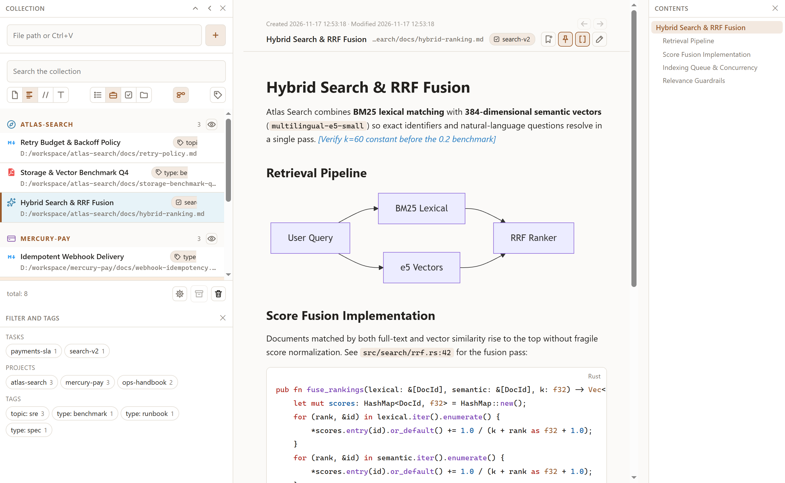
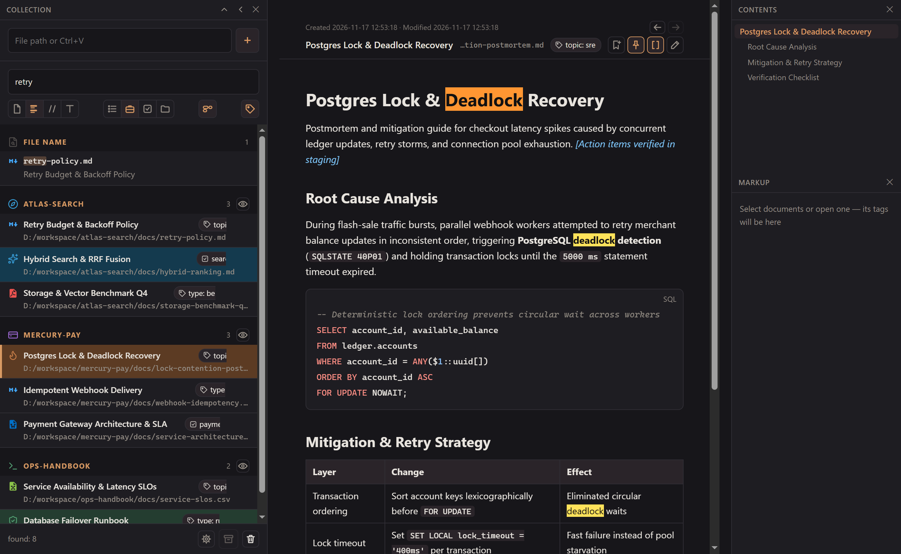
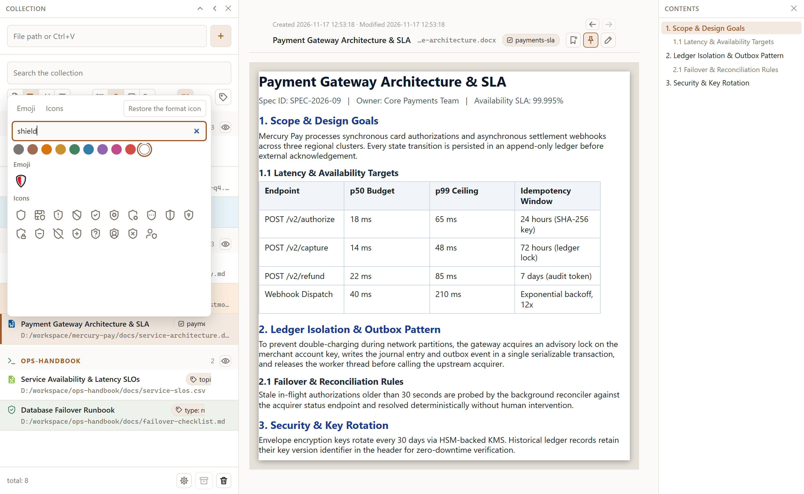
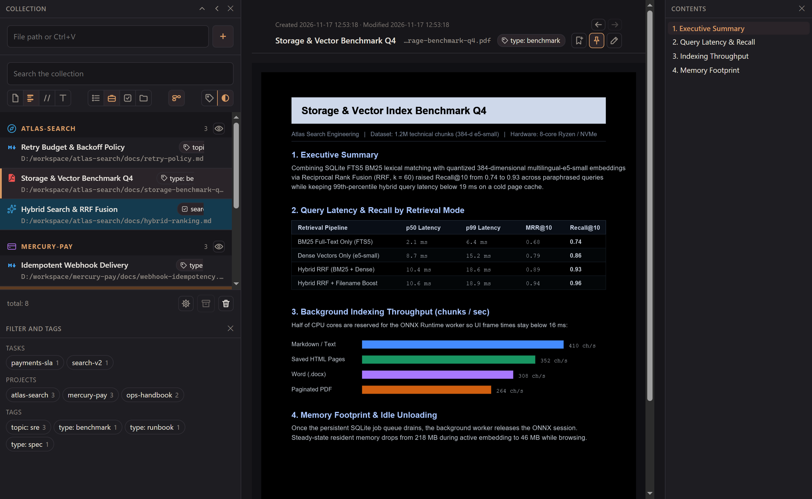

# md-keeper

**[English](README.md) · [Русский](README.ru.md) · [Deutsch](README.de.md) · Español**

Una colección local de documentos — Markdown, Word (`.docx`), PDF, páginas web guardadas, texto plano y tablas CSV — con búsqueda híbrida de texto completo y por significado para Windows y Linux.

Pensado para quienes guardan notas de arquitectura, especificaciones, análisis postmortem, informes y páginas web en distintas carpetas y repositorios, incluso junto a su IDE y sesiones de Claude Code.

Los archivos se quedan en el disco exactamente donde están: en la colección solo se guardan su ruta, título, texto para la búsqueda, etiquetas y vectores. El modelo de búsqueda semántica (`multilingual-e5-small`) se ejecuta localmente dentro del programa mediante ONNX Runtime: no abre puertos de red ni necesita conexión a internet para funcionar. El texto sale de su equipo en un único caso y solo con su consentimiento expreso: cuando Claude Code (`claude`), instalado localmente y con sesión iniciada, propone un título para un documento sin encabezado a partir de sus primeros 1500 caracteres.

[**Descargar la última versión**](../../releases/latest)



## Características principales

### Búsqueda híbrida: palabras exactas, significado y nombre de archivo

- **Tres señales en una sola barra de búsqueda.** La búsqueda de texto completo encuentra identificadores exactos, números de incidencia y símbolos de código; la búsqueda vectorial encuentra documentos formulados con sus propias palabras; ambas listas se combinan mediante Reciprocal Rank Fusion (RRF). Las coincidencias en el nombre del archivo o al final de la ruta se agrupan arriba del todo para que los archivos conocidos aparezcan siempre primero.
- **Búsqueda inmediata por palabras y cola persistente en segundo plano.** Un documento recién añadido se puede buscar por sus palabras al instante mientras los vectores se calculan en segundo plano usando la mitad de los núcleos del procesador para mantener la interfaz fluida. La cola de tareas vive en la misma base de datos SQLite que la colección: si cierra el programa a mitad de cálculo, no se pierde nada y el trabajo continúa en el siguiente inicio.
- **Búsqueda dentro del documento (`Ctrl+F`).** Salte entre coincidencias dentro del documento Markdown, Word, PDF, HTML, de texto o CSV abierto.



### Lectura en su diseño original — en tema claro u oscuro

- **Nueve extensiones con visores propios.** Admite `.md`, `.markdown`, `.mdown`, `.docx`, `.pdf`, `.html`, `.htm`, `.txt` y `.csv`:
  - **Markdown** se muestra con bloques de código resaltados, diagramas **Mermaid**, tablas y un botón opcional para resaltar `[notas entre corchetes]`.
  - **Word (`.docx`)** se dibuja página por página con su maquetación original, encabezados y tablas.
  - **PDF** se muestra página por página con selección de texto y zoom.
  - **Páginas web guardadas (`.html`)** se abren con sus propios estilos e imágenes de la carpeta contigua, manteniendo los scripts desactivados por defecto dentro de un entorno aislado (con un botón en la cabecera del documento para activarlos en diapositivas o páginas interactivas).
- **Índice de contenido en todos los formatos.** Se extrae de los encabezados en Markdown y páginas web, de los párrafos con estilo de título en Word y de los marcadores del propio archivo en PDF.
- **El tema oscuro llega hasta los documentos.** En el tema oscuro, los documentos de Word y las páginas web adaptan sus colores (texto claro conservando fotografías y diagramas tal cual) y los PDF se invierten; un botón en la cabecera del documento devuelve los colores reales en cualquier momento.
- **Puntos de lectura e historial.** La posición de desplazamiento se recuerda sola en cada documento. Puede fijar **puntos de lectura** adicionales (`1`, `2`, … o `Alt+1`, `Alt+2`) en la cabecera para saltar entre secciones de un documento largo, y recorrer el historial de documentos abiertos con `Alt+←` / `Alt+→` o los botones laterales del ratón.





### Organización sin tocar los archivos del disco

- **Detección automática de proyectos.** md-keeper sube desde la carpeta del archivo buscando indicadores de proyecto (`.git`, `package.json`, `*.sln`, `.slnx`) y asocia los documentos de un `git-worktree` a su repositorio principal. Así, la agrupación **«Proyecto»** y el filtro de proyectos funcionan desde el primer momento, incluso sin una sola etiqueta. Puede renombrar cualquier proyecto en el encabezado de su grupo o reasignar un documento a otro proyecto manualmente.
- **Etiquetas por ejes, colores de fila e iconos propios.** Marque documentos con pares `eje: valor` y tareas (`задача: …`), agrupe la lista por **Proyecto**, **Tarea** o **Carpeta** y reordene grupos o documentos arrastrándolos. Coloree las filas con 9 tonos adaptados al tema claro y oscuro, y reemplace el icono de formato de un documento o de un grupo por un **emoji** o un icono **Lucide** coloreado.
- **Ocultar a la vista y papelera reversible.** El icono del ojo en el encabezado de un grupo o `Alt+clic` sobre una etiqueta los oculta temporalmente de la vista sin modificar los documentos. Ocultar un documento con el icono de la papelera lo retira de la lista y de la búsqueda de forma reversible; los archivos del disco nunca se modifican ni se borran.
- **Localización de archivos movidos.** Si un archivo cambia de sitio o se elimina un `git-worktree`, su registro permanece en la colección con su texto y sus etiquetas. El icono de la lupa en la fila busca el archivo bajo la raíz del proyecto por el final de la ruta o el nombre de archivo y vuelve a enlazar el documento sin perder sus etiquetas.

### Salto directo de las notas a la línea de código en su IDE

- Configure una plantilla en **«Comando del IDE»** dentro de **Ajustes** (usando `{path}`, `{line}` y `{project}`). Al hacer clic en una ruta de archivo o enlace en Markdown con número de línea (como `src/search/rrf.rs:42` o `#L42`), el archivo se abre en su IDE directamente en esa línea.
- Los enlaces `jetbrains://…/navigate/…` se abren a través de JetBrains Toolbox.
- Por seguridad, los archivos ejecutables (`.exe`, `.bat`, `.cmd`, `.ps1`, `.sh`, `.desktop`, `.AppImage`, etc.) nunca se ejecutan al pulsar enlaces dentro de un documento.

### Ventana, bandeja del sistema y comando `mdk`

- **Cuatro idiomas de interfaz:** **English**, **Русский**, **Deutsch** y **Español** — se elige automáticamente según el idioma del sistema o se cambia en cualquier momento desde el menú del icono en la bandeja del sistema.
- **Sigue activo en la bandeja del sistema:** al cerrar la ventana se minimiza en la bandeja sin interrumpir la indexación en segundo plano; opcionalmente puede iniciarse con el sistema directamente en la bandeja.
- **Herramienta de línea de comandos `mdk`:** se añade al `PATH` y trabaja sobre la misma carpeta de datos, ideal para añadir documentos o sincronizar desde la terminal y sesiones de Claude Code:

| Comando | Descripción |
|---|---|
| `mdk add <ruta>` | Añade un archivo a la colección (y pone en cola un título con Claude si la opción está activa y el archivo no tiene encabezado). |
| `mdk list` | Lista los documentos de la colección. |
| `mdk sync` | Comprueba los archivos en el disco: vuelve a leer los modificados, marca los que faltan y restaura los que han vuelto a aparecer. |
| `mdk titles` | Genera títulos para los documentos cuyo título sigue siendo el nombre del archivo. |
| `mdk reindex [ruta]` | Recalcula todos los vectores de búsqueda desde cero. |

## Instalación

Descargue el instalador o el paquete desde [**Releases**](../../releases/latest).

### Windows 10 y 11 (x64)

Ejecute `md-keeper_X.Y.Z_x64-setup.exe`. No se necesitan permisos de administrador:

- Instala el programa para el usuario actual en `%LOCALAPPDATA%\Programs\md-keeper`, crea accesos directos en el Escritorio y en el menú Inicio, y añade `mdk.exe` al `PATH` del usuario (reinicie la terminal tras la instalación para que tome el nuevo `PATH`).
- Durante la instalación puede elegir la **Carpeta de datos** (por defecto, `%LOCALAPPDATA%\md-keeper\data`). El puntero a la carpeta activa se guarda en `%LOCALAPPDATA%\md-keeper\location.json`, y puede mover o cambiar la carpeta más adelante desde el menú del icono en la bandeja (**«Carpeta de datos…»**).
- Si el equipo no cuenta con Microsoft Edge WebView2 Runtime (viene incluido en Windows 10 desde abril de 2018 y en Windows 11), el instalador descarga el instalador oficial de Microsoft.

**Aviso de SmartScreen.** El instalador aún no está firmado digitalmente, por lo que Windows puede mostrar la ventana *«Windows protegió su PC»*. Haga clic en **«Más información»** y luego en **«Ejecutar de todas formas»**. Puede comprobar que el archivo es el correcto comparando su suma con `SHA256SUMS`:

```powershell
certutil -hashfile md-keeper_X.Y.Z_x64-setup.exe SHA256
```

### Linux (x86_64, Ubuntu 22.04 o posterior)

```bash
sudo apt install ./md-keeper_X.Y.Z_amd64.deb
```

- `apt` instalará automáticamente WebKitGTK, GTK y la biblioteca AppIndicator para el icono de la bandeja, colocará `md-keeper` y `mdk` en `/usr/bin` y añadirá la entrada en el menú de aplicaciones.
- Por defecto, los datos se guardan en `~/.local/share/md-keeper/data` (o `$XDG_DATA_HOME/md-keeper/data`), y el puntero de ubicación en `~/.local/share/md-keeper/location.json`.
- Para verificar el paquete descargado con `SHA256SUMS`:

```bash
sha256sum -c SHA256SUMS --ignore-missing
```

## Carpeta de datos y privacidad

| Ruta dentro de la carpeta de datos | Contenido |
|---|---|
| `collection.db` | Base de datos SQLite: metadatos, etiquetas, índice de texto completo, fragmentos vectoriales y cola de tareas. |
| `md-keeper-webview/` | Perfil de la ventana y preferencias de disposición de la interfaz. |
| `md-keeper-logs/server.log` | Registro del programa (rotación automática al alcanzar 5 MB). |

- **Totalmente sin conexión por defecto.** El modelo de embeddings y ONNX Runtime viajan dentro del instalador y del paquete; el programa no abre puertos de red ni realiza peticiones en segundo plano.
- **Títulos con Claude — solo con su consentimiento.** En el primer inicio (o en cualquier momento desde **Ajustes**, mediante el engranaje al pie del panel «Colección»), puede autorizar a md-keeper a pedir a `claude` (Claude Code CLI instalado en su equipo) que proponga títulos para los documentos sin encabezado enviando los primeros 1500 caracteres. Mientras no active esta opción, `claude` no se invoca nunca.

## Qué tener en cuenta

- **Sincronización con el disco.** Los cambios en los archivos se detectan al iniciar el programa, al refrescar la lista en la ventana o al ejecutar `mdk sync` — no hay vigilancia continua de archivos en segundo plano.
- **PDF escaneados sin capa de texto.** Se pueden añadir, leer en el visor y encontrar por nombre de archivo, título y etiquetas, pero no por el contenido de sus páginas (no incluye reconocimiento óptico de caracteres / OCR).
- **Actualizaciones.** Aún no hay actualización automática en segundo plano; instalar una versión nueva sobre la anterior conserva intactas su carpeta de datos y su colección.

## Licencias

Los textos completos de las licencias del código de terceros, bibliotecas, iconos y del modelo incluidos en el programa se instalan junto a él:

- **Windows:** `THIRD-PARTY-NOTICES.txt` en la carpeta del programa (`%LOCALAPPDATA%\Programs\md-keeper\THIRD-PARTY-NOTICES.txt`).
- **Linux:** `/usr/share/doc/md-keeper/THIRD-PARTY-NOTICES.txt`.

© Andrei Martyshchenko. Todos los derechos reservados. El código fuente del programa es cerrado.
