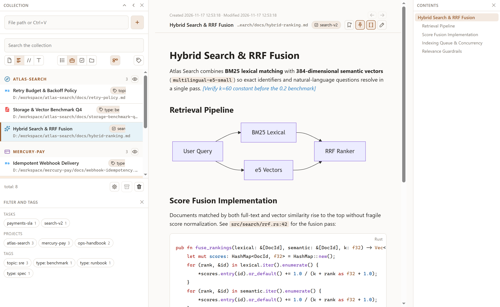
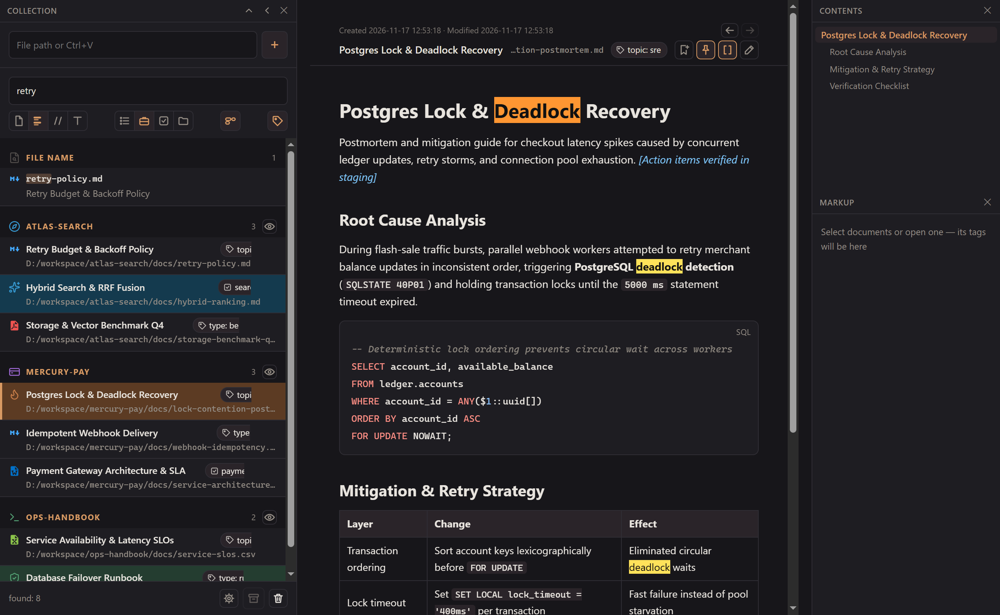
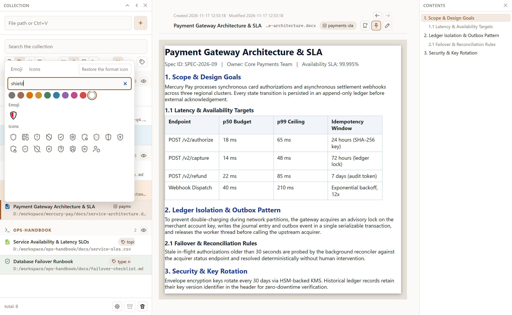
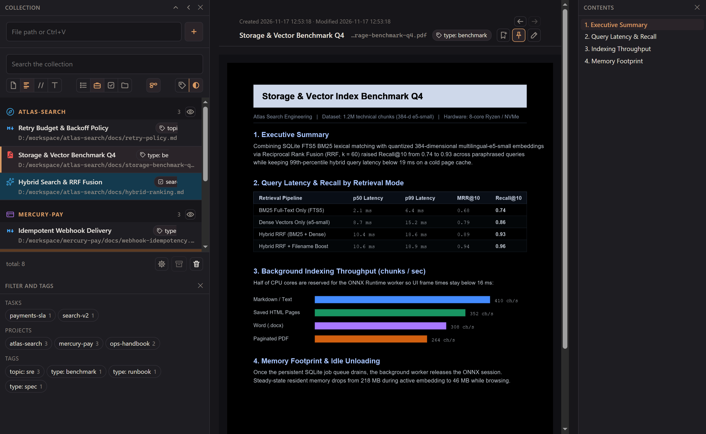

# md-keeper

**English · [Русский](README.ru.md) · [Deutsch](README.de.md) · [Español](README.es.md)**

A local collection of documents — Markdown, Word (`.docx`), PDF, saved HTML pages, plain text, and CSV — with hybrid full-text and semantic search for Windows and Linux.

Built for people who keep architectural notes, specifications, postmortems, reports, and saved web pages scattered across repositories and folders, including alongside an IDE and AI coding sessions.

Your files stay where they are on disk: the collection stores only their path, title, searchable text, tags, and search vectors. The semantic embedding model (`multilingual-e5-small`) runs locally inside the app via ONNX Runtime — no network ports are opened and no internet connection is needed. Text leaves your computer in one case only and only with your explicit consent: when locally installed, signed-in Claude Code (`claude`) generates a title for an untitled document from its first 1,500 characters.

[**Download the latest release**](../../releases/latest)



## Highlights

### Hybrid Search: Exact Words, Meaning & File Names

- **Three signals in one search bar.** Full-text search finds exact identifiers, issue numbers, and code symbols; vector search matches queries phrased in your own words; Reciprocal Rank Fusion (RRF) merges both rankings. Matches on the file name or path tail are grouped at the top so known files are always first.
- **Searchable immediately, indexed in a persistent queue.** A newly added document is searchable by its text right away while embeddings compute in the background on half of the CPU cores so the interface stays responsive. The job queue lives in SQLite alongside the collection: closing the app mid-indexing loses nothing, and unfinished jobs resume on next launch.
- **In-document search (`Ctrl+F`).** Jump across matches inside the open Markdown, Word, PDF, HTML, text, or CSV document.



### Read in Original Layout — Light or Dark

- **Nine file extensions, native viewers.** Open `.md`, `.markdown`, `.mdown`, `.docx`, `.pdf`, `.html`, `.htm`, `.txt`, and `.csv`:
  - **Markdown** renders with syntax-highlighted code blocks, **Mermaid** diagrams, tables, and an optional toggle to highlight `[notes in square brackets]`.
  - **Word (`.docx`)** renders page by page with its original layout, headers, and tables.
  - **PDF** renders page by page with text selection and zoom.
  - **Saved web pages (`.html`)** load with their own styles and local assets from adjacent folders while scripts stay disabled in a strict sandbox (with an explicit per-document toggle when you need live interactive slides).
- **Table of contents for every format.** Extracted from headings in Markdown and HTML, heading styles in Word, and document bookmarks in PDF.
- **Dark mode that reaches into documents.** In dark theme, Word and HTML documents are restyled (light text while keeping photos and diagrams intact) and PDFs are inverted; a button in the document header restores original colors at any time.
- **Reading places & history.** Scroll position is remembered automatically for each document. Pin additional **reading places** (`1`, `2`, … or `Alt+1`, `Alt+2`) in the header to jump between sections of a long spec, and navigate across previously opened documents with `Alt+←` / `Alt+→` or mouse back/forward buttons.





### Organize Without Touching Files on Disk

- **Automatic project detection.** md-keeper walks up from each file's directory looking for project markers (`.git`, `package.json`, `*.sln`, `.slnx`), mapping git worktrees back to their main repository. Even without a single tag, grouping by **Project** works out of the box. You can rename any project in place or reassign a document to another project manually.
- **Multi-axis tags, colors & icons.** Tag documents with `axis: value` pairs (and `задача` for tasks), group the list by **Project**, **Task**, or **Folder**, and reorder groups or documents via drag-and-drop. Paint rows in 9 theme-aware palette colors and replace format icons with custom **Emoji** or colored **Lucide** icons on individual documents or entire groups.
- **Declutter & reversible hiding.** Click the eye icon on a group header or `Alt+click` a tag to hide it from view temporarily without changing the documents. Moving a document to the hidden/trash view removes it from the list and search reversibly; files on disk are never modified or deleted.
- **Locate moved files.** When a file is moved or a git worktree is deleted, its entry stays in the collection with its tags and searchable text. Click the magnifying glass on the missing row to scan the project root for matching path tails or file names and relink the entry in place.

### Jump Straight from Notes to Code in Your IDE

- Configure an **IDE command** template in Settings (using `{path}`, `{line}`, and `{project}` placeholders). Clicking a file reference with a line number in Markdown (such as `src/search/rrf.rs:42` or `#L42`) opens the file at that exact line in your editor.
- Links using `jetbrains://…/navigate/…` open directly through JetBrains Toolbox.
- For safety, executable files (`.exe`, `.bat`, `.cmd`, `.ps1`, `.sh`, `.desktop`, `.AppImage`, etc.) are never launched from document links.

### Window, System Tray & `mdk` CLI

- **Four interface languages:** **English**, **Русский**, **Deutsch**, and **Español** — chosen automatically from your system locale or switched anytime from the tray menu.
- **Lives in the system tray:** closing the window minimizes to the tray so background indexing continues uninterrupted; optional autostart launches quietly into the tray on sign-in.
- **`mdk` command-line tool:** installed into your `PATH` and connected to the same data folder, making it easy to add files or sync from terminal scripts and Claude Code sessions:

| Command | Description |
|---|---|
| `mdk add <path>` | Add a file to the collection (and queue a Claude title if enabled and the file has no heading). |
| `mdk list` | List all documents in the collection. |
| `mdk sync` | Check files on disk: re-read modified files, mark missing ones, and restore returned ones. |
| `mdk titles` | Queue title generation for documents whose title is still their file name. |
| `mdk reindex [path]` | Recompute search vectors from scratch. |

## Installation

Download the installer or package from [**Releases**](../../releases/latest).

### Windows 10 and 11 (x64)

Run `md-keeper_X.Y.Z_x64-setup.exe`. No administrator rights are needed:

- Installs for the current user into `%LOCALAPPDATA%\Programs\md-keeper`, creates Desktop and Start Menu shortcuts, and adds `mdk.exe` to your user `PATH` (restart your terminal after setup so it picks up the updated `PATH`).
- Lets you choose the **Data folder** during setup (default: `%LOCALAPPDATA%\md-keeper\data`). The pointer to the active data folder is stored in `%LOCALAPPDATA%\md-keeper\location.json`, and you can move or switch the data folder later from the tray menu (**Data folder…**).
- If Microsoft Edge WebView2 Runtime is not yet present on the machine (it is preinstalled on Windows 10 since April 2018 and on all Windows 11 systems), the installer downloads Microsoft's bootstrapper.

**SmartScreen notice.** The installer is not code-signed yet, so Windows SmartScreen may show *"Windows protected your PC"*. Click **More info**, then **Run anyway**. You can verify the installer against `SHA256SUMS` from the release page:

```powershell
certutil -hashfile md-keeper_X.Y.Z_x64-setup.exe SHA256
```

### Linux (x86_64, Ubuntu 22.04 or newer)

```bash
sudo apt install ./md-keeper_X.Y.Z_amd64.deb
```

- `apt` automatically pulls in WebKitGTK, GTK, and the AppIndicator tray icon library, installs `md-keeper` and `mdk` into `/usr/bin`, and adds a desktop application entry.
- By default, data is stored in `~/.local/share/md-keeper/data` (or `$XDG_DATA_HOME/md-keeper/data`), with the location pointer at `~/.local/share/md-keeper/location.json`.
- To verify the downloaded package against `SHA256SUMS`:

```bash
sha256sum -c SHA256SUMS --ignore-missing
```

## Data Folder & Privacy

| Path inside Data Folder | Purpose |
|---|---|
| `collection.db` | SQLite database: document metadata, tags, full-text index, vector chunks, and job queue. |
| `md-keeper-webview/` | Window profile and UI layout preferences. |
| `md-keeper-logs/server.log` | Application log (rotated automatically at 5 MB). |

- **Fully offline by default.** The embedding model and ONNX Runtime ship inside the installer/package; the program opens no network ports and makes no background network requests.
- **Opt-in titles by Claude.** On first launch (or in **Settings** via the gear icon at the bottom of the Collection panel), you can optionally allow md-keeper to ask locally installed `claude` (Claude Code CLI) to title documents that have no heading, sending the first 1,500 characters of such documents to Anthropic. Until you explicitly turn this on, `claude` is never called.

## What to Expect

- **Explicit disk sync.** File changes are picked up on program launch, when refreshing the list in the window, or when running `mdk sync` — there is no background file watcher.
- **Scanned PDFs without a text layer.** Scanned PDFs can be added, read in the viewer, and found by file name, title, and tags, but not by page text (there is no built-in OCR).
- **Updates.** There is no automatic background updater yet; installing a newer version over an existing one preserves your data folder and collection.

## Licenses

The full license texts of all third-party crates, libraries, icons, and the embedding model included in the distribution are installed alongside the program:

- **Windows:** `THIRD-PARTY-NOTICES.txt` in the program folder (`%LOCALAPPDATA%\Programs\md-keeper\THIRD-PARTY-NOTICES.txt`).
- **Linux:** `/usr/share/doc/md-keeper/THIRD-PARTY-NOTICES.txt`.

© Andrei Martyshchenko. All rights reserved. The program's source code is closed.
