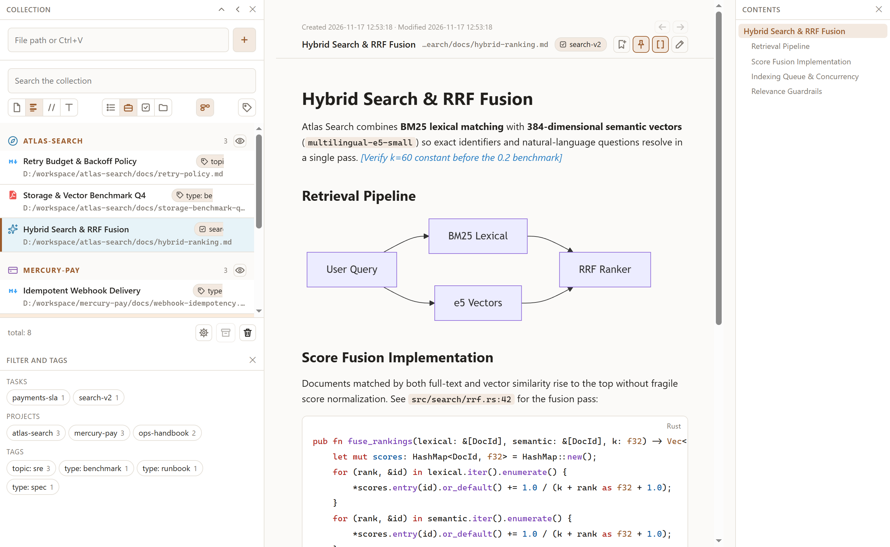
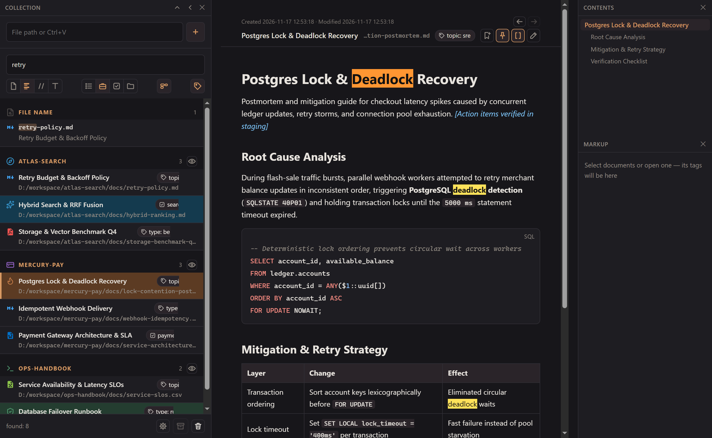
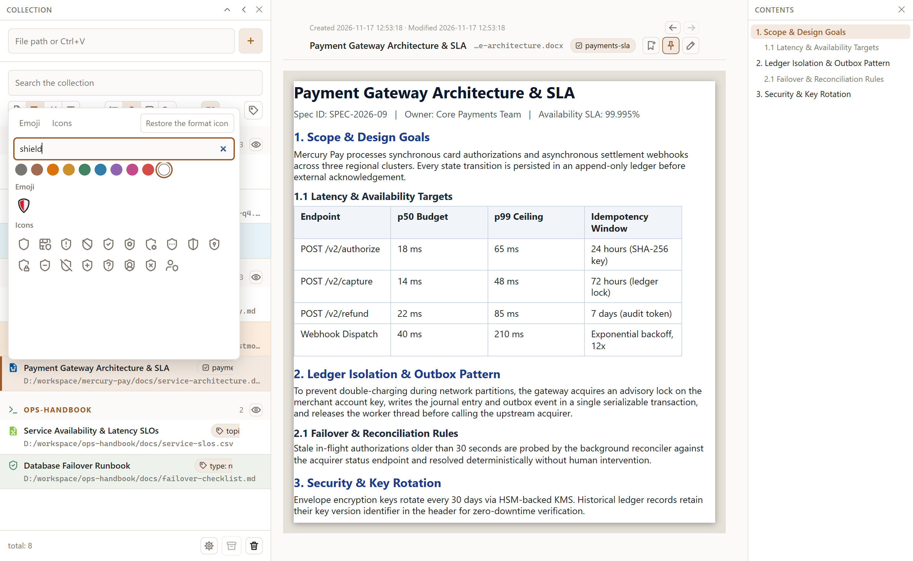
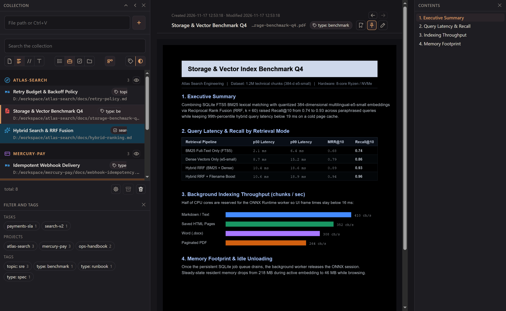

# md-keeper

**[English](README.md) · Русский · [Deutsch](README.de.md) · [Español](README.es.md)**

Локальная коллекция документов — Markdown, Word (`.docx`), PDF, сохранённых веб-страниц, текста и таблиц CSV — с гибридным полнотекстовым и смысловым поиском для Windows и Linux.

Программа создана для тех, кто хранит архитектурные заметки, спецификации, разборы инцидентов, отчёты и сохранённые веб-страницы в разных каталогах и репозиториях, в том числе рядом с IDE и сессиями Claude Code.

Файлы остаются на диске там, где лежат: в коллекцию попадают только путь, название, текст для поиска, теги и векторы. Модель смыслового поиска (`multilingual-e5-small`) работает локально внутри программы через ONNX Runtime — сетевые порты не открываются, интернет для работы не нужен. Наружу текст уходит только в одном случае и только с вашего явного согласия: когда установленный на компьютере и вошедший в аккаунт Claude Code (`claude`) по первым 1500 символам придумывает заголовок документу без заголовка.

[**Скачать последний выпуск**](../../releases/latest)



## Возможности

### Гибридный поиск: точные слова, смысл и имена файлов

- **Три сигнала в одной строке поиска.** Полнотекстовый поиск находит точные идентификаторы, номера задач и имена в коде; векторный поиск — документы по запросу своими словами; списки сливаются через Reciprocal Rank Fusion (RRF). Совпадения по имени файла и хвосту пути выделяются в отдельную группу сверху, чтобы знакомый файл всегда находился первым.
- **Поиск по словам сразу, векторы — в фоновой очереди.** Добавленный документ сразу ищется по словам из текста, пока векторы считаются в фоне на половине ядер процессора, не задерживая интерфейс. Очередь задач хранится в той же базе SQLite, что и коллекция: закрытая на середине программа ничего не теряет и при следующем запуске доводит начатое до конца.
- **Поиск внутри документа (`Ctrl+F`).** Переход по совпадениям прямо в открытом документе Markdown, Word, PDF, HTML, тексте или таблице CSV.



### Чтение в исходном виде — в светлой и тёмной теме

- **Девять расширений и собственные просмотрщики.** Принимаются `.md`, `.markdown`, `.mdown`, `.docx`, `.pdf`, `.html`, `.htm`, `.txt` и `.csv`:
  - **Markdown** рисуется с подсветкой кода, диаграммами **Mermaid**, таблицами и переключателем подсветки `[заметок в квадратных скобках]`.
  - **Word (`.docx`)** показывается постранично со своей вёрсткой, колонтитулами и таблицами.
  - **PDF** открывается постранично с выделением текста и масштабированием.
  - **Сохранённые веб-страницы (`.html`)** открываются со своими стилями и картинками из соседней папки, при этом скрипты по умолчанию выключены в песочнице (для интерактивных презентаций и живых страниц их можно включить кнопкой в шапке документа).
- **Оглавление у всех форматов.** Строится по заголовкам у Markdown и веб-страницы, по абзацам со стилем заголовка у Word и по закладкам самого файла у PDF.
- **Тёмная тема доходит до документов.** В тёмной теме Word и веб-страницы аккуратно перекрашиваются (светлый текст при неизменных фотографиях и схемах), а PDF инвертируется; кнопка в шапке документа в один клик возвращает исходные цвета.
- **Места чтения и история переходов.** Позиция прокрутки запоминается сама. В длинном документе кнопкой в шапке можно завести несколько **мест чтения** (`1`, `2`, … или `Alt+1`, `Alt+2`) и переключаться между ними, а по истории открытых документов ходить стрелками в шапке, `Alt+←` / `Alt+→` или боковыми кнопками мыши.





### Порядок без правки файлов на диске

- **Автоматическое определение проектов.** Программа поднимается от папки файла вверх по цепочке признаков (`.git`, `package.json`, `*.sln`, `.slnx`) и относит документы из `git-worktree` к основному репозиторию. Поэтому группировка **«Проект»** и фильтр по проектам работают сразу, даже на коллекции без единого тега. Проект можно переименовать прямо в заголовке группы или назначить документу вручную.
- **Теги по осям, цвета строк и свои иконки.** Размечайте документы парами `ось: значение` и задачами (`задача: …`), группируйте список по **проектам**, **задачам** или **папкам**, меняйте порядок групп и документов перетаскиванием. Строки красятся в 9 цветов палитры (со своими оттенками для светлой и тёмной темы), а значок формата у документа или группы заменяется на **эмодзи** или цветной значок **Lucide**.
- **Скрытие с глаз и обратимая корзина.** Значок глаза на заголовке группы и `Alt+клик` по тегу временно убирают лишнее с экрана, не меняя сами документы. Удаление в корзину убирает документ из списка и выдачи обратимо, с кнопкой возврата; файлы на диске не трогаются ни в одном из случаев.
- **Переезд пропавших файлов.** Если файл переложили или удалили рабочую копию `git-worktree`, запись остаётся в коллекции со старым текстом и тегами. Лупа в строке пропавшего документа ищет файл под корнем проекта по хвосту пути и имени и переставляет запись на новое место.

### Переход из заметок прямо к строке кода в IDE

- Задайте шаблон **«Команда IDE»** в настройках (с подстановками `{path}`, `{line}` и `{project}`). Щелчок по пути к файлу или ссылке с номером строки в Markdown (например, `src/search/rrf.rs:42` или `#L42`) откроет файл в вашей IDE сразу на нужной строке.
- Ссылки `jetbrains://…/navigate/…` открываются через JetBrains Toolbox.
- Запускаемые файлы (`.exe`, `.bat`, `.cmd`, `.ps1`, `.sh`, `.desktop`, `.AppImage` и др.) по ссылкам из документов никогда не запускаются.

### Окно, трей и команда `mdk`

- **Четыре языка интерфейса:** **English**, **Русский**, **Deutsch** и **Español** — язык выбирается автоматически по системе или переключается в меню значка в трее.
- **Работа в трее:** закрытие окна крестиком прячет его в трей, не прерывая фоновую индексацию; можно включить автозапуск вместе с системой сразу в трей.
- **Команда `mdk` в терминале:** ставится в `PATH` и работает с той же папкой данных, что и окно, — удобно добавлять документы и сверять коллекцию из терминала и сессий Claude Code:

| Команда | Что делает |
|---|---|
| `mdk add <путь>` | Добавить файл в коллекцию (для документа без заголовка поставит задачу на заголовок через Claude, если функция включена). |
| `mdk list` | Показать документы коллекции. |
| `mdk sync` | Сверить коллекцию с диском: перечитать изменённые файлы, пометить пропавшие, вернуть появившиеся. |
| `mdk titles` | Поставить задачи на генерацию заголовков документам, которые всё ещё зовутся именем файла. |
| `mdk reindex [путь]` | Пересчитать векторы смыслового поиска целиком. |

## Установка

Скачайте установщик или пакет в разделе [**Releases**](../../releases/latest).

### Windows 10 и 11 (x64)

Запустите `md-keeper_X.Y.Z_x64-setup.exe`. Права администратора не нужны:

- Программа ставится для текущего пользователя в `%LOCALAPPDATA%\Programs\md-keeper`, создаёт ярлыки на рабочем столе и в меню «Пуск», ставит `mdk.exe` и добавляет папку программы в пользовательский `PATH` (перезапустите терминал после установки, чтобы он увидел новый `PATH`).
- На шаге **«Папка данных»** можно оставить папку по умолчанию (`%LOCALAPPDATA%\md-keeper\data`) или выбрать другую. Указатель на неё хранится в `%LOCALAPPDATA%\md-keeper\location.json`; перенести или переключить папку данных позже можно из меню трея (**«Папка данных…»**).
- Если в системе нет WebView2 (на Windows 10 с апреля 2018 года и на Windows 11 он уже установлен), установщик скачает загрузчик у Microsoft.

**Предупреждение SmartScreen.** Установщик пока не подписан, поэтому Windows может показать окно *«Windows защитила ваш компьютер»*. Нажмите **«Подробнее»**, затем **«Выполнить в любом случае»**. Проверить контрольную сумму файла по `SHA256SUMS` со страницы выпуска:

```powershell
certutil -hashfile md-keeper_X.Y.Z_x64-setup.exe SHA256
```

### Linux (x86_64, Ubuntu 22.04 и новее)

```bash
sudo apt install ./md-keeper_X.Y.Z_amd64.deb
```

- `apt` сам подтянет WebKitGTK, GTK и библиотеку значков трея AppIndicator, положит `md-keeper` и `mdk` в `/usr/bin` и добавит пункт в меню приложений.
- Папка данных по умолчанию — `~/.local/share/md-keeper/data` (или `$XDG_DATA_HOME/md-keeper/data`), указатель на неё — `~/.local/share/md-keeper/location.json`.
- Проверить скачанный пакет по `SHA256SUMS`:

```bash
sha256sum -c SHA256SUMS --ignore-missing
```

## Папка данных и приватность

| Путь внутри папки данных | Что там |
|---|---|
| `collection.db` | База SQLite: метаданные документов, теги, полнотекстовый индекс, чанки с векторами и очередь задач. |
| `md-keeper-webview/` | Профиль окна и настройки раскладки интерфейса. |
| `md-keeper-logs/server.log` | Журнал программы (автоматическая ротация при 5 МБ). |

- **Полностью офлайн по умолчанию.** Модель эмбеддингов и ONNX Runtime входят в установщик и пакет; программа не открывает сетевых портов и не делает фоновых запросов в сеть.
- **Заголовки через Claude — только с согласия.** При первом запуске (или в окне **«Настройки»** по шестерёнке внизу панели «Коллекция») можно разрешить md-keeper просить установленный на компьютере `claude` (Claude Code CLI) придумывать заголовки документам без заголовка по первым 1500 символам текста. Пока вы явно не включите эту настройку, `claude` не вызывается.

## Чего ждать

- **Сверка с диском по запросу и при запуске.** Правки в файлах подхватываются при запуске программы, при обновлении списка в окне или по команде `mdk sync` — фонового слежения за файлами нет.
- **PDF-сканы без текстового слоя.** Добавляются, читаются в окне и находятся по имени файла, названию и тегам, но не по тексту страниц (встроенного распознавания текста нет).
- **Обновления.** Автообновления пока нет: новая версия ставится поверх старой, папка данных и коллекция при этом сохраняются.

## Лицензии

Полные тексты лицензий стороннего кода, библиотек, наборов значков и модели эмбеддингов, входящих в поставку, устанавливаются рядом с программой:

- **Windows:** `THIRD-PARTY-NOTICES.txt` в папке программы (`%LOCALAPPDATA%\Programs\md-keeper\THIRD-PARTY-NOTICES.txt`).
- **Linux:** `/usr/share/doc/md-keeper/THIRD-PARTY-NOTICES.txt`.

© Andrei Martyshchenko. Все права защищены. Исходный код программы закрыт.
